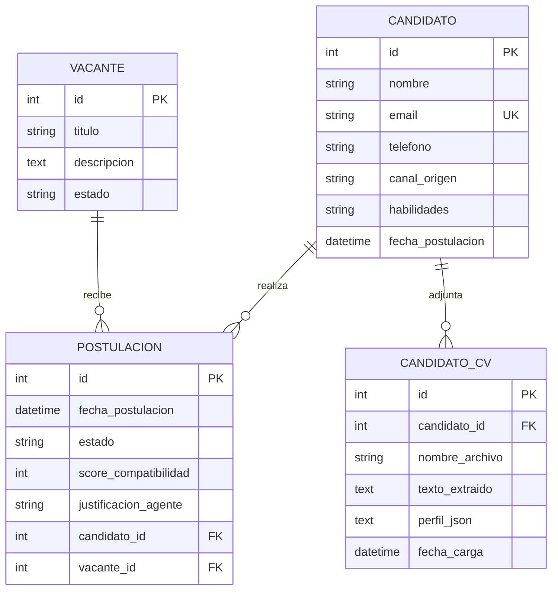

# Arquitectura del backend de PluriOne

## 1. Resumen

El backend de PluriOne es una API HTTP construida con **FastAPI**, persistencia
relacional con **SQLAlchemy** y **PostgreSQL** como base de datos. Se ejecuta
como aplicación ASGI mediante Uvicorn.

Sus responsabilidades principales son:

- Administrar candidatos, vacantes y postulaciones.
- Recibir registros de candidatos desde canales externos simulados (WhatsApp
  Business y correo electrónico).
- Recibir CV en PDF, extraer su texto en memoria con **PyPDF2** y evaluar su
  afinidad con una vacante mediante **Google Gemini**.
- Conservar una evaluación simulada como respaldo si Gemini no está configurado
  o falla.

## 2. Estructura y componentes

| Archivo | Responsabilidad |
| --- | --- |
| `backend/main.py` | Crea la aplicación FastAPI, configura rutas, dependencias y operaciones HTTP. |
| `backend/database.py` | Carga `DATABASE_URL`, crea el engine SQLAlchemy y configura sesiones. |
| `backend/models.py` | Define las entidades `Candidato`, `CandidatoCV`, `Vacante` y `Postulacion`. |
| `backend/schemas.py` | Valida payloads y define esquemas de entrada/salida, incluidos los envelopes de canales. |
| `backend/ia_agent.py` | Extrae texto de PDF, construye un perfil estructurado y evalúa afinidad con Gemini o el evaluador simulado. |

La variable `DATABASE_URL` se configura por entorno o en `backend/.env`. Al
iniciar la aplicación, `models.Base.metadata.create_all(bind=engine)` crea las
tablas que todavía no existan y `ensure_cv_profile_column()` incorpora
`perfil_json` en tablas de CV creadas por versiones anteriores.

## 3. Modelo de datos

Un candidato puede tener varias postulaciones y cada vacante puede recibir
varias postulaciones. La tabla `Postulacion` relaciona ambas entidades e incluye
el estado del proceso, la fecha, el score de afinidad y la justificación de la
evaluación.



El correo del candidato es único. Por ello, si una integración intenta registrar
de nuevo un correo ya existente, PostgreSQL rechaza la operación y la API
revierte la transacción.

## 4. Endpoints principales

| Método | Ruta | Descripción |
| --- | --- | --- |
| `GET` | `/` | Comprueba que la API está disponible. |
| `POST` | `/candidatos/` | Registra un candidato desde la aplicación. |
| `POST` | `/api/v1/candidatos/con-cv` | Crea un candidato mediante multipart y guarda el nombre y texto extraído del PDF opcional, sin conservar el binario. |
| `GET` | `/candidatos/` | Lista candidatos y sus postulaciones. |
| `POST` | `/vacantes/` | Crea una vacante. |
| `GET` | `/vacantes/` | Lista vacantes. |
| `PUT` | `/vacantes/{vacante_id}` | Actualiza una vacante. |
| `DELETE` | `/vacantes/{vacante_id}` | Elimina una vacante; devuelve 404 si no existe. |
| `DELETE` | `/candidatos/{candidato_id}` | Elimina un candidato; devuelve 404 si no existe. |
| `POST` | `/postulaciones/` | Crea una postulación entre un candidato y una vacante. |
| `GET` | `/vacantes/{vacante_id}/postulaciones` | Lista las postulaciones de una vacante con los candidatos relacionados. |
| `POST` | `/agente/evaluar/{postulacion_id}` | Evalúa y guarda score y justificación en una postulación existente. |
| `POST` | `/agente/evaluar-cv/{vacante_id}` | Recibe un PDF y devuelve una evaluación para una vacante sin guardar el archivo ni asociarla a una postulación. |
| `POST` | `/api/v1/candidatos/{candidato_id}/cv?vacante_id={vacante_id}` | Recibe el CV de un candidato asociado a una postulación, evalúa y guarda el resultado en dicha postulación. |

## 5. Integraciones omnicanal

Los webhooks de canal requieren el header `X-API-Key`, que se compara con la
variable de entorno `WEBHOOK_API_KEY`. Si la clave no está configurada, la API
responde `503`; si la clave recibida falta o no coincide, responde `401`.
El registro de cada candidato es transaccional: los errores de SQLAlchemy
provocan un `rollback` y una respuesta HTTP de error.

### 5.1 WhatsApp Business

`POST /api/v1/canales/whatsapp` recibe un envelope JSON reducido inspirado en el
formato de WhatsApp Business Platform de Meta. Los esquemas Pydantic validan
`object`, `entry`, `changes`, `value`, `contacts` y `messages`.

El campo `candidate_email` es una extensión necesaria para este MVP: WhatsApp no
entrega por sí solo una dirección de correo. La aplicación integradora debe
recopilarla durante la conversación. El endpoint busca el mensaje cuyo `from`
corresponde con el `wa_id` del contacto y normaliza los datos así:

| Campo persistido | Origen |
| --- | --- |
| `nombre` | `contacts[0].profile.name` |
| `email` | `value.candidate_email` |
| `telefono` | `contacts[0].wa_id` |
| `canal_origen` | Valor fijo `WhatsApp` |
| `habilidades` | `messages[].text.body` del contacto correspondiente |

Ejemplo abreviado:

```json
{
  "object": "whatsapp_business_account",
  "entry": [{
    "changes": [{
      "value": {
        "candidate_email": "ana@example.com",
        "contacts": [{
          "profile": { "name": "Ana Pérez" },
          "wa_id": "525512345678"
        }],
        "messages": [{
          "from": "525512345678",
          "text": { "body": "Experiencia en React y TypeScript" }
        }]
      }
    }]
  }]
}
```

### 5.2 Correo electrónico

`POST /api/v1/canales/email` recibe un evento simplificado de un proveedor de
correo. Solo admite `event: "email.received"`. Normaliza nombre y email desde
`from`, usa `message.text` como texto de habilidades y fija `canal_origen` en
`Email`. El asunto se valida, pero no se persiste en el esquema actual.

```json
{
  "event": "email.received",
  "from": {
    "name": "Luis García",
    "email": "luis@example.com"
  },
  "message": {
    "subject": "Postulación - Ingeniero de Datos",
    "text": "Experiencia en Python, SQL y pipelines de datos"
  }
}
```

Los dos formatos son adaptadores académicos, no receptores directos completos de
las especificaciones externas. Para producción deben añadirse, entre otros,
validación de firma del proveedor, idempotencia, manejo de reintentos y
observabilidad.

## 6. Agente evaluador y flujo técnico de carga de CV

El formulario de creación utiliza `POST /api/v1/candidatos/con-cv` para crear un
candidato y adjuntar un CV opcional. El backend recibe los campos como
`multipart/form-data`; si se adjunta un PDF, extrae su texto y lo persiste en
`CandidatoCV` junto con el nombre original. También ejecuta el agente extractor
y persiste el JSON validado en `CandidatoCV.perfil_json`. El archivo
binario se mantiene en memoria durante la solicitud y no se guarda en el servidor.
Esta ruta no ejecuta la evaluación de afinidad.

El endpoint recomendado para asociar la evaluación al historial del candidato es
`POST /api/v1/candidatos/{candidato_id}/cv`. Recibe el campo multipart
`archivo` y requiere `vacante_id` como parámetro de consulta, ya que un candidato
puede postular a más de una vacante.

Flujo:

1. FastAPI recibe el PDF mediante `UploadFile` y `File`.
2. Se valida que existan el candidato, la vacante y una postulación que los
   relacione.
3. El endpoint lee el archivo en memoria, con un máximo de 10 MB. No lo escribe
   en disco ni lo conserva después de la solicitud.
4. `ia_agent.extraer_texto_pdf` crea un `io.BytesIO` con los bytes recibidos y
   usa `PyPDF2.PdfReader` para extraer y concatenar el texto de todas las
   páginas.
5. Un archivo vacío, corrupto, que no sea PDF o que no tenga texto extraíble se
   rechaza con HTTP `400`. Los archivos sobre el límite se rechazan con HTTP
   `413`.
6. `ia_agent.extraer_perfil` recibe el texto completo y usa el agente extractor
   de `google-genai` para producir JSON estricto con `habilidades`,
   `anios_experiencia`, `idiomas` y `resumen`. La respuesta se valida antes de
   usarla.
7. El perfil JSON se guarda como texto en `CandidatoCV.perfil_json`; el texto
   original extraído continúa disponible en `CandidatoCV.texto_extraido`.
8. `ia_agent.evaluar_candidato` recibe `perfil_json` y la descripción de la
   vacante, sin volver a incluir el CV completo en el prompt. El agente
   evaluador solicita una comparación semántica a **Gemini 1.5 Flash**
   (`gemini-1.5-flash`). El resultado es JSON con score entero de `0` a `100`
   y una justificación breve.
9. Si Gemini no está configurado, falla o devuelve datos inválidos, el extractor
   construye un perfil local y/o el evaluador usa `evaluar_candidato_simulado`,
   que compara las habilidades detectadas con las requeridas por la vacante. La
   fuente de la evaluación se identifica como `gemini` o `simulado`.
10. El endpoint persiste `score_compatibilidad` y `justificacion_agente` en la
    postulación y devuelve el resultado con la fuente de evaluación. Si la
    persistencia falla, revierte la transacción y responde con error HTTP.

El score es una señal orientativa para el equipo de reclutamiento y no una
decisión automatizada de empleo. La extracción de texto no incluye OCR para
documentos escaneados.

## 7. Configuración y ejecución

Las variables sensibles no se incluyen en el repositorio. `GEMINI_API_KEY` y
`WEBHOOK_API_KEY` se configuran en `backend/.env` para el servicio backend.
`DATABASE_URL` conecta con PostgreSQL; en Docker Compose el host de la base de
datos es el nombre del servicio correspondiente.

Desde la raíz del repositorio:

```bash
docker compose up --build
```

La API FastAPI queda disponible localmente en `http://localhost:8000` y su
documentación interactiva en `http://localhost:8000/docs`.
